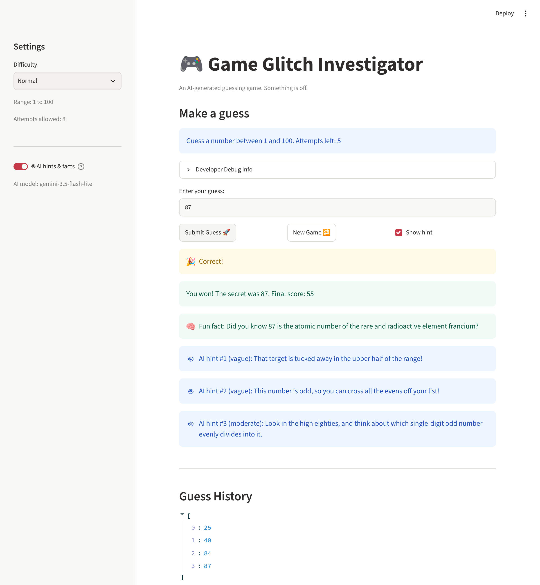
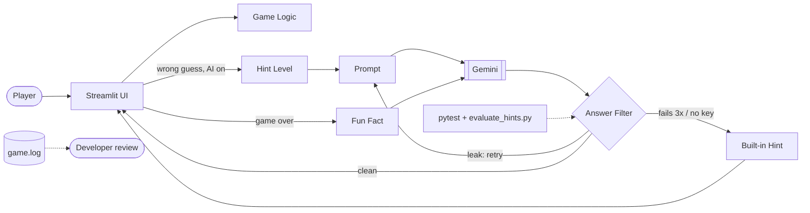

# 🎮 Game Glitch Investigator: AI Hints & Facts

A Streamlit number-guessing game with an **AI hint-giver powered by Google Gemini**.
Turn on the 🤖 toggle and, after every wrong guess, Gemini writes a riddle-style hint that gets
**more specific the more attempts you use**. When the game ends, it shares a **fun fact** about the
secret number. A guardrail filters out any AI response that gives away the answer, and the whole
system is logged, unit-tested and measured by a reliability evaluation script.



**Why it matters:** an LLM in a game knows the answer and is told to keep it secret. That makes it a
small, measurable version of a real AI problem: getting a model to be *helpful without revealing what it
shouldn't*, and staying reliable when the model or the network fails.

---

## 📜 Original Project

This project extends **Game Glitch Investigator: The Impossible Guesser** from Module 1 (Project 1).
That project started as a deliberately broken, AI-generated Streamlit guessing game. My goal was to find
and fix its bugs: reversed "higher/lower" hints, a secret number that reset on every click, invalid input
using up attempts, out-of-range secrets, broken scoring and history that never cleared. I refactored the
game logic out of the UI into `logic_utils.py` and wrote 22 pytest tests to prove each fix.

---

## ✨ What's New in the Final Project

| Feature | Where | What it does |
|---|---|---|
| 🤖 AI toggle | `app.py` sidebar | Turns AI hints and facts on or off. When it's off, the game plays exactly like Project 1. |
| Progressive AI hints | `ai_hints.py` → `generate_hint()` | The hint level rises with attempts used: **vague → moderate → specific → very specific** (last attempt). The prompt includes past guesses and past hints so each hint builds on the last. |
| Answer filter (guardrail) | `contains_secret()` | Each AI response is checked for the secret as digits (`42`) or words (`forty-two`). A leaking response is **thrown out** and the AI is asked again with feedback (max 3 tries). After that, a built-in hint is used. |
| End-of-game fun fact | `generate_fun_fact()` | After a win or a loss, Gemini shares one fun fact about the secret number. |
| Error handling | `GeminiClient`, `generate_hint()` | A missing key, rate limits (429), outages (503) and timeouts never crash the game. It retries with backoff, then falls back to built-in hints. |
| Logging | `logging_config.py` → `logs/game.log` | Every guess, game, AI call, filtered leak, error, fallback and latency is recorded. |
| Reliability testing | `tests/test_ai_hints.py`, `evaluate_hints.py` | Unit tests use a fake AI to prove leaks are filtered. The evaluation script measures leak, fallback, error and repeat rates plus latency on real Gemini. |

---

## 🏗️ Architecture Overview

The full diagram is in [`diagrams/architecture.mmd`](diagrams/architecture.mmd) (Mermaid source).



**How data flows:**
1. **Input:** the player types a guess. `logic_utils.py` validates it and returns *Too High / Too Low / Win* plus the score. This part is pure Python, so it's predictable and fully tested.
2. **AI processing:** if the guess is wrong and the toggle is on, the **Hint Level Planner** picks how specific to be from the attempts used. The **Prompt Builder** packs in the secret, range, attempts, past guesses and past hints. **Gemini** writes the hint.
3. **Guardrail:** the **Answer Filter** checks the response. If it contains the answer, the response is discarded and Gemini is asked again with a warning. If the AI keeps failing or is unreachable, a **built-in fallback hint** is used instead.
4. **Output:** the hint is shown and saved in session state. At game over, the **Fun Fact Generator** asks Gemini for a fact about the now-revealed number.
5. **Testing & human review:** `pytest` checks the game logic and the filter (with a fake AI). `evaluate_hints.py` runs many simulated games against real Gemini. I review the report, the logs and the hint quality by hand. Everything is written to `logs/game.log`.

---

## 🛠️ Setup Instructions

**Requirements:** Python 3.10+ and a free Google Gemini API key.

1. **Clone the repo and open the folder:**
   ```bash
   git clone https://github.com/Chris-VSanchez/AI-110_Project_4.git
   cd AI-110_Project_4
   ```
2. **Install dependencies:**
   ```bash
   pip install -r requirements.txt
   ```
3. **Get a free Gemini API key** at <https://aistudio.google.com/apikey>.
4. **Create a `.env` file** from the example (`cp` on Mac/Linux, `copy` on Windows):
   ```bash
   cp .env.example .env
   ```
   Then open `.env` and paste your key:
   ```
   GEMINI_API_KEY=your-key-here
   ```
   `.env` is in `.gitignore`, so the key is never committed. *(Optional)* Set `GEMINI_MODEL` to choose
   another Gemini model. The default is `gemini-3.5-flash-lite`.
5. **Run the game:**
   ```bash
   python -m streamlit run app.py
   ```
6. In the sidebar, turn on **🤖 AI hints & facts** and start guessing.

> **No API key?** The game still runs. The sidebar shows *"AI is offline"*, and built-in hints are
> used instead, so anyone can run the project.

---

## 💬 Sample Interactions

Real outputs from `gemini-3.5-flash-lite`, copied from the app and `evaluation/gemini_eval_report.txt`.

**Example 1: hints get more specific (Normal, 1–100, secret = 32)**

| Input (attempt) | Hint level | AI output |
|---|---|---|
| Wrong guess #1 | vague | "That number is in the lower half of the range." |
| Wrong guess #3 | moderate | "It is an even number that can be divided evenly by eight." |
| Wrong guess #5 | specific | "It sits in the thirties decade, and the sum of its digits equals five." |
| Wrong guess #7 (last chance) | very specific | "This is your absolute final chance, so try the even multiple of sixteen that sits in the lower thirties!" |

**Example 2: full game in the app (Normal, secret = 87)**, shown in the screenshot above

| Input | AI output |
|---|---|
| Guess `25` → Too Low | 🤖 "That target is tucked away in the upper half of the range!" |
| Guess `40` → Too Low | 🤖 "This number is odd, so you can cross all the evens off your list!" |
| Guess `84` → Too Low | 🤖 "Look in the high eighties, and think about which single-digit odd number evenly divides into it." |
| Guess `87` → Win | 🧠 "Did you know 87 is the atomic number of the rare and radioactive element francium?" |

**Example 3: the answer filter at work (from the unit tests and the offline mock evaluation)**

| AI response | Filter result | What the player sees |
|---|---|---|
| "The answer is 42!" | ❌ contains `42`, so retry | next AI attempt |
| "Think forty-two." | ❌ contains the words, so retry | next AI attempt |
| "It's a multiple of 6." | ✅ clean | "It's a multiple of 6." |
| 3 leaks in a row | ❌❌❌ | built-in hint: "It's somewhere between 40 and 44." |

**Example 4: AI unavailable (no API key)**. The sidebar shows *"AI is offline (GEMINI_API_KEY is not set)"*,
and the game gives built-in hints like 💡 "It's an odd number." and a fun fact like "91 is written as 1011011 in binary."

---

## 🧭 Design Decisions

- **The AI only writes the hints. Python still decides higher/lower, scoring and winning.** The core game
  stays deterministic and tested, and the AI adds to it without being able to break it.
- **Progressive hint levels are set in code, not by the AI.** `get_hint_level()` maps attempts used to
  four levels, so "more specific over time" is guaranteed and testable. Gemini only decides *how* to say it.
- **Filter the answer instead of fact-checking every hint.** I considered a Python "property engine" that
  would verify each hint was true. I chose not to build it: for a game, hint variety mattered more than a
  complex verifier. **Trade-off:** hints can occasionally be wrong (see Testing). The thing that would
  actually ruin the game, *saying the answer*, is still blocked.
- **The filter is conservative on purpose.** It rejects any standalone appearance of the secret, even when
  harmless (for example, "its digits add up to 1" when the secret is 1). A wasted retry is better than a spoiled game.
- **Retry with feedback, then fall back.** A leaking response is retried with "your last hint revealed the
  answer." After 3 tries, a built-in hint is used. Rate limits and outages get exponential backoff. The game
  never freezes or crashes because of the AI.
- **Only numbers go into the prompt.** Guesses are parsed to integers before they reach Gemini, so a player
  can't type instructions that hijack the AI (prompt injection).
- **Gemini free tier and `gemini-3.5-flash-lite`.** Free, fast (~0.6–2.5 s) and good enough for one-sentence
  hints. **Trade-off:** free-tier rate limits, which the retry/fallback logic and the evaluation's `--delay` handle.
- **A fake model for tests.** `generate_hint()` accepts any object with `generate(prompt)`, so tests run
  offline, instantly and deterministically. Anyone can run `pytest` without a key.

---

## 🧪 Testing Summary

**Automated tests:** **66 / 66 pytest tests pass** (22 from Project 1 + 44 new), with no API key needed.
They cover hint-level progression, the answer filter (digits, words, `142` ≠ `42`), retry-after-leak, always-leaking → fallback, API errors → fallback, missing key, and that fallback hints never reveal the answer for any secret.

```bash
python -m pytest -v
```

**Reliability evaluation on real Gemini** (`python evaluate_hints.py --secrets 3`):

```
=== AI Hint Reliability Report ===
Hints generated        : 33  (33 AI calls)
Raw leak rate (AI)     : 0.0%  <- responses filtered for revealing the answer
Final leak rate        : 0.0%  <- must be 0%
Fallback rate          : 0.0%
Error rate             : 0.0%
Repeated hint rate     : 0.0%
Avg AI calls per hint  : 1.00
Avg latency            : 654 ms
Avg words by level     : vague=12.4, moderate=10.8, specific=14, very specific=16
PASS: no answer reached the player.
```
Full results: [`evaluation/gemini_eval_report.txt`](evaluation/gemini_eval_report.txt) and [`evaluation/gemini_eval_results.json`](evaluation/gemini_eval_results.json).
To test the filter offline, run `python evaluate_hints.py --mock`. The mock AI leaks about 30% of the time, and the final leak rate is still 0%.

**Human review of the 33 Gemini hints:**

| Check | Result |
|---|---|
| Factually correct | **29 / 33 (88%)** |
| Said the answer in digits or words | **0 / 33** |
| Pointed to exactly one number without saying it | **10 / 33**, 7 of them on the "very specific" last-chance level |

**What worked:** the filter and fallbacks. The answer never reached the player in any run. The level system
clearly works: later hints are longer and narrower.

**What didn't:**
- **4 hints were false.** Examples: "It is a prime number and also a multiple of three" for **9**, and "the highest possible even number in the forties" for **44**.
- **Some hints gave the answer away indirectly.** For example, "the positive integer immediately following three" for **4**. The filter only catches the number written out.
- **Rate limits on the first run.** With 0.5 s between calls, **31% of calls hit 429 rate limits**. The game fell back cleanly, and raising the delay to 4 s brought errors to 0%.

**What I learned:** Gemini was good at *not saying* the number but bad at simple math, and it was
"helpful" enough to give the answer away indirectly. Measuring with real data, not just playing a few
rounds, is what showed this.

---

## 💭 Reflection

This project taught me that adding AI to a program is the easy part. Making it *dependable* is the real
work. One prompt got Gemini writing good hints in minutes. Most of the effort went into everything around
it: deciding what the AI is and isn't allowed to control, catching the outputs I never want a player to
see, keeping the game playable when the API is rate-limited or missing, and measuring behavior instead of
trusting a few good-looking runs. In Project 1, I debugged code an AI wrote. Here, I learned to design a
system that expects the AI to be wrong sometimes and stays correct anyway.

📄 My responsible-AI reflection (limitations, misuse, testing surprises and AI collaboration) is in
[`model_card.md`](model_card.md). My Project 1 reflection is in [`reflection.md`](reflection.md).

---

## 📁 Project Structure

```
app.py                 Streamlit UI and game flow (AI toggle, hints, fun fact)
logic_utils.py         Pure game logic from Project 1 (ranges, parsing, hints, scoring)
ai_hints.py            Gemini client, hint levels, prompts, answer filter, fallbacks
logging_config.py      Shared file + console logging (logs/game.log)
evaluate_hints.py      Reliability evaluation script (real Gemini or --mock)
tests/                 pytest suites: game logic + AI hints (fake AI model)
evaluation/            Saved Gemini evaluation report and raw results
diagrams/              Mermaid architecture diagram (architecture.mmd)
assets/                Screenshots
model_card.md          Responsible-AI reflection
reflection.md          Project 1 reflection
.env.example           Template for your Gemini API key
```